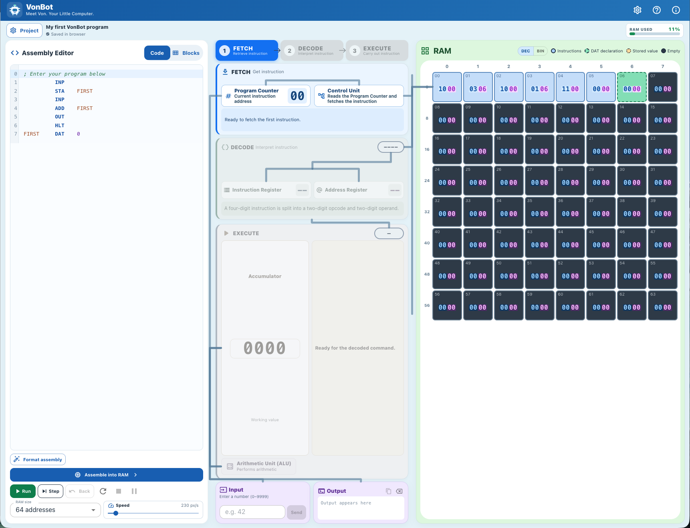
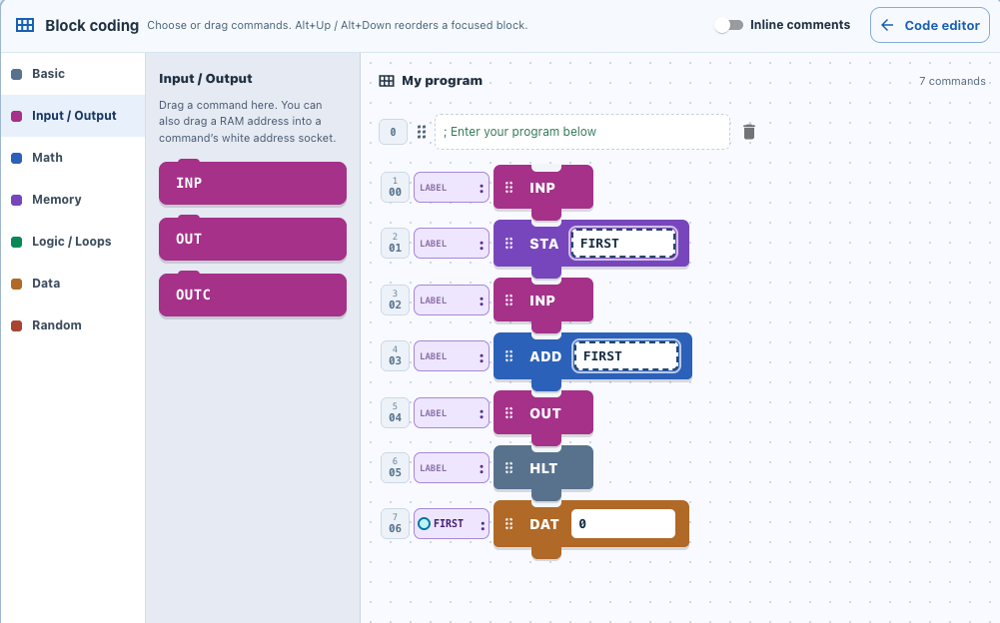

# VonBot

**Meet Von. Your Little Computer.**

VonBot is a free, open-source computer simulator designed to help students understand how computers execute instructions. It makes the **fetch → decode → execute** cycle visible while students write and run programs in a simplified assembly language or a colorful block editor.



## 1. What is VonBot?

VonBot is a teaching tool for exploring the **Von Neumann architecture**, the idea that a computer stores both instructions and data in memory. Rather than hiding what happens inside a processor, VonBot lets students watch instructions move through the CPU and see their effects on registers, RAM, input, and output.

Students can:
- Write simple assembly programs or compose instructions using blocks.
- Follow the **Fetch**, **Decode**, and **Execute** stages, one step at a time.
- See the **Program Counter**, **Accumulator**, **Instruction Register**, and RAM change as a program runs.
- Use input, output, arithmetic, memory, branching, and random-number instructions.
- Experiment with execution speed and explore accessible color and high-contrast display modes.

VonBot is an **educational model**, not a way to run programs written for a real-world CPU. Its instruction set is deliberately simplified for learning.



## 2. How do I install it?

The easiest way to run VonBot for a classroom is with **Docker**. Docker runs the application in a container so you do not have to install Node.js or configure a web server yourself.

**You'll need:** a computer or server with Docker installed, network access for downloading the image, and a web browser. Portainer is optional, but convenient if you prefer a graphical interface.

### Option A — Portainer (recommended for classroom servers)

1. Open Portainer, choose your Docker environment, then go to **Stacks → Add stack**.
2. Name your stack `vonbot`.
3. Choose **Web editor** and paste the following configuration:

```yaml
services:
  vonbot:
    image: ghcr.io/shields10-cal/vonbot:latest
    pull_policy: always
    restart: unless-stopped
    ports:
      - "2003:3000"
    environment:
      NODE_ENV: production
```

4. Select **Deploy the stack**. Portainer downloads the image and starts VonBot.
5. Visit **http://YOUR_SERVER_IP:2003**, replacing `YOUR_SERVER_IP` with the IP address of your Docker server. If using Docker on your own computer, visit **http://localhost:2003**.

**Using a different port:** change only the first number in `"2003:3000"`; for example, `"8080:3000"` makes the simulator available on port 8080.

**Updating VonBot:** changes to this repository are built into a Docker image automatically, but they **do not deploy to your classroom automatically**. When you want an update, open the stack in Portainer, choose **Editor → Update the stack**, and ensure the latest image is pulled. Verify the simulator after redeploying.

### Option B — Docker command line

On a computer with Docker installed, run:

```bash
docker run -d --name vonbot --restart unless-stopped -p 2003:3000 ghcr.io/shields10-cal/vonbot:latest
```

Then open **http://localhost:2003** (or use the Docker server's IP address on another device).

To update a command-line installation, pull the latest image, stop and remove the existing container, and repeat the run command:

```bash
docker pull ghcr.io/shields10-cal/vonbot:latest
docker stop vonbot
docker rm vonbot
docker run -d --name vonbot --restart unless-stopped -p 2003:3000 ghcr.io/shields10-cal/vonbot:latest
```

**Deployment notes:** VonBot requires no database, sign-in, or student accounts. Individual projects are automatically saved **in each browser**; they are not synchronized across devices. Students should save a copy of important programs using the Project menu before clearing browser data, switching devices, or using shared computers. The server health endpoint is `/api/health`.

## 3. How do I use it?

Start by entering a short assembly program in the **Assembly Editor**, or switch to **Blocks** to build the same program visually. Choose **Assemble into RAM** to load the instructions into the simulated computer.

For example, this program asks for two numbers and outputs their sum:

```asm
        INP
        STA FIRST
        INP
        ADD FIRST
        OUT
        HLT

FIRST:  DAT 0
```

- **Step** advances through the CPU's operations so students can observe what happens in each stage.
- **Run** executes the program continuously. Adjust **Speed** to slow down or speed up the visualization.
- **RAM** shows stored instructions and data. Watch the **Program Counter** identify the next instruction and the **Accumulator** hold working values.
- **Input** accepts numbers requested by `INP`; **Output** displays results from output instructions.
- **Blocks** provides a visual way to explore commands before moving to text-based assembly.

Use **Project** to save or load program files. Use the **?** button in the simulator to find the available commands. For first-time learners, stepping through a short program is often more useful than immediately pressing Run.

## 4. How can I use this with students?

VonBot is intentionally an **open-ended sandbox**: there is no single prescribed lesson, sequence, or correct project. Students can start with adding two numbers and progress to comparisons, branches, loops, reusable data locations, and more complex programs as their understanding grows.

A useful classroom progression is to have students **predict** what an instruction will do, **step** through the fetch–decode–execute process, **observe** changes to the CPU and RAM, and then **explain** why the result occurred. You can also ask students to construct a program using blocks and compare it with the equivalent assembly text.

The goal is to add **ready-to-use classroom labs and teacher resources to this repository**. Teachers who would like existing lab materials or want to share suggestions can contact **[shields10@calcharter.org](mailto:shields10@calcharter.org)**.

For classroom deployment, consider testing the server address from a student device before the lesson. Since work is stored in the browser, students should export or save important work rather than relying exclusively on automatic browser storage.

## 5. Credits

**VonBot was created by Tobin Shields** as an educational tool for teaching computer architecture and introductory assembly programming.

The project was inspired by **Peter Higginson's [Little Man Computer (LMC)](https://www.peterhigginson.co.uk/lmc/)**, which has helped learners explore how computers execute instructions. VonBot builds on that educational inspiration with a different interface, visual fetch–decode–execute simulation, an extended simplified instruction set, and block-based programming.

**VonBot is an independent project and is not affiliated with, sponsored by, or endorsed by Peter Higginson or the Little Man Computer project.**

VonBot is distributed under the [MIT License](LICENSE).
